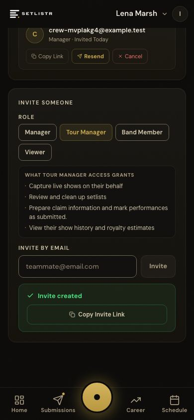
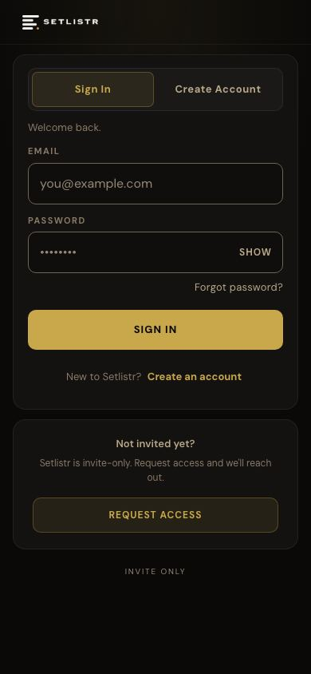
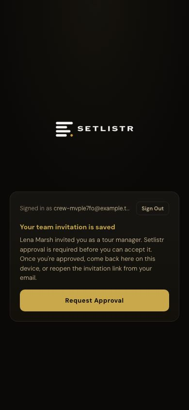
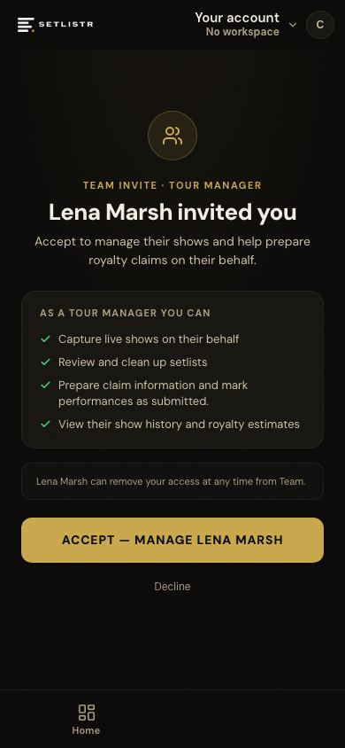
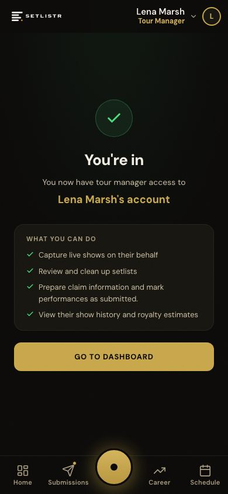
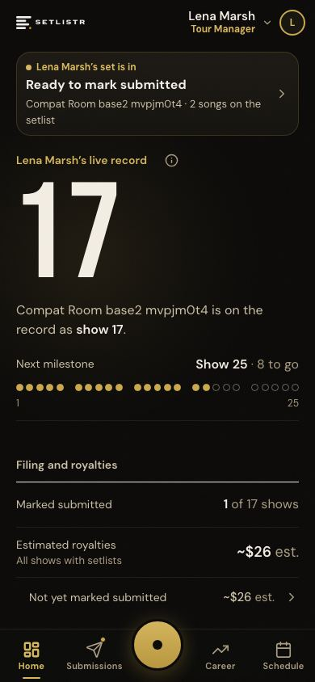

# Team invitation and admission: proposal

*Prepared 2026-10-26 from `main` at `577dd3d`, which is in production.* Nothing here is approved for building. **Findings** describe what the code does today. **Proposal** sections are for the owner to decide.

This slice combines two items:
- **P1** from [team-journey-assessment](team-journey-assessment.md): let an accepted invite admit the invitee.
- The open **R2** decision in [team-invite-identity](team-invite-identity.md): invite links act as bearer links.

It adds no new role, no onboarding system and no permission redesign. Owner and manager invitation authority stays as it is.

## 1. Today's journey, traced (finding)

This walkthrough ran on the disposable stack, with the deployed app's code. No team-related file changed between `3ce4833` and `577dd3d`. The harness is [team-invite-admission/invite-walk.js](team-invite-admission/invite-walk.js).

| # | Step | What happens | Code |
|---|---|---|---|
| 1 | The owner invites a tour manager by email | An invite row is created. For an address with no account yet, `delegate_id` is null (a placeholder). An email goes out with the link, and the owner also gets **Copy Invite Link**. | `app/api/team/invite/route.ts` |
| 2 | The invitee opens the link, signed out | Middleware sends them to sign-in, keeping `next=/app/accept-invite?token=…` | `middleware.ts:208` |
| 3 | The invitee creates an account | "Confirm email" is off, so they're signed in straight away and sent on to the accept link | `app/auth/login/page.tsx` |
| 4 | **Block A: middleware** | The signed-in user has no `beta_invites` row and isn't an admin, so every `/app/*` page redirects to `/beta`. From the accept link, middleware first saves the token in the pending-invite cookie. **The accept page never renders.** | `middleware.ts:275–322` |
| 5 | `/beta` | Shows "Your team invitation is saved… Setlistr approval is required before you can accept it," with Request Approval | `app/beta/page.tsx`, `BetaSignedInStatus` |
| 6 | **Block B: the accept API** | Even if called directly, `POST /api/team/accept` returns 403 `admission_required`. The admission check runs before the token is read, so it blocks every case, including a repeated acceptance. | `app/api/team/accept/route.ts:124–129` |
| 7 | An admin grants access | Only an admin can insert a `beta_invites` row for the address. The approval email links the person back to their pending invite. | `app/api/admin/beta-invite/route.ts:43,162` |
| 8 | The invitee returns | `/beta` resumes the saved invite, then: accept screen → Accept → "You're in" → the Dashboard, in the artist's workspace, with the assigned role | `middleware.ts:328`, `app/app/accept-invite/page.tsx` |
| 9 | **Block C: every later visit** | Admission is checked on every page load, so without step 7 even an accepted teammate couldn't open the workspace | `middleware.ts:275` |

**Admission rules today** (`lib/betaAdmission.ts`, `middleware.ts`):
- A person is admitted if they're an admin or their email has a `beta_invites` row. The `sl_beta_ok` cookie caches that for an hour.
- Admission is **per email address and covers the whole app**, so an admitted person can also set up their own artist workspace.
- Neither a session's email nor admission proves who controls an inbox ("Confirm email" is off).
- Admission is enforced on **pages only** (the middleware matcher), plus `POST /api/team/accept`. Other API routes don't check admission today. This proposal doesn't change that either way.

What else the run confirmed:
- `POST /api/team/accept` returned 403 `admission_required` while the invitee wasn't admitted.
- After admission, accepting bound the invite (`tour_manager`, accepted).
- A repeated acceptance returned `200 already_accepted`.

**Invite validity today:**
- **No expiry.** A token stops working only when the invite is revoked, or when a revoked invite is re-sent with a new token. Resending a pending invite reuses the same token.
- **Repeated acceptance** is idempotent, and two accepts racing each other are safe.
- **Manager requests** can never be accepted through this route.

### Before and after, on the real app

**Before (today):**

| Owner sends invite | Link, signed out | After sign-up: blocked |
|---|---|---|
|  |  |  |

Then an admin grants access, and the invitee reaches:

| Accept | You're in | Artist workspace (Tour Manager) |
|---|---|---|
|  |  |  |

**After (proposed):**
1. The owner sends the invite (unchanged).
2. The invitee opens the link and signs in or creates an account (unchanged).
3. **The accept screen opens straight away,** with one added step: "Confirm it's you: we've emailed a 6-digit code to your address."
4. Accept → "You're in" → the artist's workspace, in the assigned role.

The `/beta` stop and the admin step disappear for this one invite only. Everything shown above is real, unchanged app UI. The code step is **not built and not mocked**: it would be one input on the existing accept screen.

## 2. The security decision (proposal)

**Recommended: an accepted invite admits its invitee to that one workspace, after the invitee proves they control the invited inbox.** This is R2 option 1 (inbox proof), applied wherever acceptance relies on an email identity.

Why the two go together: today, an admin's approval stands between a forwarded or copied link and access. Remove that step without inbox proof, and anyone holding the link who types the invited address at sign-up gets straight into the workspace. Inbox proof closes that gap. It also closes R2 for people who are already admitted.

| Case | Today | Proposed |
|---|---|---|
| Invitee not admitted, invite to their existing account (bound) | Blocked at `/beta` until an admin approves | Session + token + **inbox code** → accepted and admitted to this workspace |
| Invitee not admitted, invite to an address with no account (placeholder) | Blocked at `/beta` | The account must use the invited address; session + token + **inbox code** → bound, accepted, admitted to this workspace |
| Already admitted, bound invite | Session + token | **Unchanged** |
| Already admitted, placeholder invite | Session + token + a typed email match (the R2 risk) | Adds the **inbox code** (closes R2) |
| Signed in with a different address than the invite | "Wrong account" | **Unchanged.** No code is sent to the invited address from a mismatched session. |
| Revoked invite | "No longer valid" | **Unchanged** |
| Invite last sent more than 14 days ago (*the window is the owner's decision*) | Still works | Can't admit a new person: "Ask for a new invite." Resend refreshes the date. Already-admitted people are unaffected. |
| Repeated or double acceptance | Idempotent | **Unchanged.** An accepted invitee reopening the link goes to the workspace. |
| A manager's request | Never acceptable here | **Unchanged** |

**How "admitted to this workspace" works:**
- Middleware gains a third admission state, **team**: no `beta_invites` row and not an admin, but at least one accepted, unrevoked delegation where `delegate_id = auth.uid()`.
  - It's tied to the account id, not the email address.
  - It's a live read through the user's own session (the existing `artist_delegates_select` policy already allows this), with no cache, so removing someone takes effect on their next page load.
  - It fails closed: a lookup error sends the person to `/beta`.
- **Scope:** team-admitted users get an **allowlist of workspace pages** (Dashboard, Manager, Team, Schedule, show capture and upload, Live, Review, Submit, History, Stats, Career, Proof, Artist, account settings, accept-invite). Any other page redirects to `/app/manager`. In particular they can't reach artist onboarding or create their own artist identity, and they can't request to manage other artists: `POST /api/team/request` would require full admission.
- **Data access is unchanged:** the existing row-level security (`can_act_for`, `can_write_for`) limits them to the invited artist and assigned role.
- **No `beta_invites` row is written,** so no broader beta access is granted. Admin Grant access works as today. If a team member later needs their own artist workspace, that still goes through admin approval.
- **Inviting authority is unchanged.** Only the owner and managers can invite (`canCreateInvite`). The policy change, which you need to accept explicitly: **a manager's invite would now admit someone to that one workspace without an admin.**

**Inbox proof mechanism (recommended, to verify first):** Supabase Auth's own email code, sent to the session's **own** address only, and only when that address is the invite's recipient.
- The accept route checks the session's `amr` claim for a recent `otp` (within 15 minutes).
- **No database migration.**
- **Dependencies to confirm before building:**
  - Production Auth email delivery: custom SMTP or Supabase's built-in sender (which has low rate limits), and whether the email template includes the code. You can check this in the Supabase dashboard; changing it would be an environment change needing its own approval.
  - That `amr` behaves as expected. Check on the disposable stack, whose local mail catcher receives the codes.
- **Fallback if that doesn't fit:** a Setlistr code sent through Resend, the same provider the invite emails use. That needs a small table, so a migration and SQL approval.

**Not proposed:** turning on "Confirm email" globally (R2 option 2; it changes every sign-up and doesn't prove old accounts), a new role, or new onboarding screens.

**Residual risk:** an attacker who controls the invited inbox. That's the same trust the invite email itself relies on.

## 3. Acceptance criteria

All tested on the disposable stack, using its local mail catcher. None run on Preview, because Preview uses production Supabase and would send real email.

1. **New person, placeholder invite:** link → create an account with the invited address → accept screen (no `/beta`) → code → Accept → the artist's workspace in the assigned role. No `beta_invites` row is created.
2. **Existing, unadmitted account with a bound invite:** sign in → code → Accept → workspace. No `/beta`.
3. **No inbox proof, no acceptance:** an unadmitted session with no recent code gets 403 (`inbox_proof_required`) from `POST /api/team/accept`, called directly.
4. **Codes go only to the right address:** to the session's own address, and only if it is the invite's recipient. A mismatched session sees "Wrong account" and **no email is sent** anywhere.
5. **Forwarded link:** a stranger who signs up with the invited address but can't read that inbox can't accept. One who signs up with a different address sees "Wrong account."
6. **Scope:**
   - a team-admitted user reaches only allowlisted pages;
   - `/app/onboarding` and any other unlisted page redirect to `/app/manager`;
   - `POST /api/team/request` returns 403;
   - the existing row-level security tests for their role still pass (a Viewer can't write; a tour manager can capture and review).
7. **Removal:** revoking access sends a team-admitted user to `/beta` on their next page load. A person with a `beta_invites` row keeps their general access.
8. **Expiry:** an invite older than the window can't admit a new person; Resend refreshes it. An already-admitted person can still accept it.
9. **Idempotent:** repeating or double-clicking Accept writes nothing twice. A previously accepted invitee goes to the workspace. A manager's request is never acceptable.
10. **Unchanged:**
    - only the owner and managers can invite;
    - admitted users accepting bound invites see no new step;
    - admin Grant access and its approval email work as before;
    - `/beta` works for everyone without an invite.
11. **Fails closed:** any lookup or code-check error denies (`/beta`, or 503), never admits.
12. **Regressions:** `scripts/test-team-lifecycle.ts` passes, with new sections for criteria 1–9. `npx tsc --noEmit` is clean.

## 4. Kept separate (not part of this slice)

- **P2, recording who reviewed, marked submitted and uploaded:** useful for the manager questions. It needs a migration, which **isn't authorised.** Not started.
- **P3, capture versus submission authority.** Two different acts:
  - **Recording a submission:** "Mark as submitted" sets `performances.submission_status` and `submitted_at`. It's the user's own statement inside Setlistr.
  - **Filing with a PRO:** done in the PRO's own portal by whoever that PRO authorises, under rules that differ by PRO. They're unverified, and SOCAN, ASCAP, BMI, PRS, APRA, SESAC and GMR must all be treated equally.

  A later proposal would decide which Setlistr roles may *record* a submission. Setlistr can't decide who may *file*.
- **P4, reminders: groundwork only. No channel is selected and no automation is built.**
  - **Who's responsible for capture:** nobody is assigned today. Any member who can capture may start a show, and the app doesn't record an intended capturer.
  - **Existing prompts:**
    - in the app only: Schedule's Start on the next show, and the Dashboard's morning-after band ("Give the setlist a quick look," then "Ready to mark submitted");
    - no show emails or push notifications. Emails go only for team invites, requests and approvals; the weekly digest is internal.
  - **Native infrastructure:**
    - the iOS app uses Capacitor 8 with only the Haptics plugin;
    - there are no push or local-notification plugins, no `aps-environment` entitlement and no notification registration in `AppDelegate`;
    - `Info.plist` declares background audio mode;
    - the web app has a manifest but no service worker, so there's no web push.

## 5. Capture with the phone locked: unverified, not broken

The live page asks the screen to stay awake (Wake Lock), and the iOS app declares background audio mode. **Nobody has observed whether capture continues while the phone is locked or the app is in the background.** That's recorded as unverified, not as a defect.

**Proposed real-device check, about 10 minutes.** It needs your go-ahead, since it writes one test show to production:
1. **Where:** the installed iPhone app, signed in to your own account or a dedicated test account. It must not be during or near any artist's show, and must not be in any artist's workspace.
2. Start a capture from New show, named **"Locked-phone test"**. Play recorded music from another device.
3. After about two minutes with the app open (expect detections), lock the phone for three minutes, with the music still playing.
4. Unlock. Note whether the timer kept running, whether songs were detected during the lock, and any message on screen.
5. Repeat with the app in the background (switch to another app) instead of locked.
6. End the show. Remove the test show through History's existing edit and delete, so the record stays clean.
7. Record the results in this document: verified, partly verified, or not supported. Make no change to capture code; any fix would be a separate proposal.
